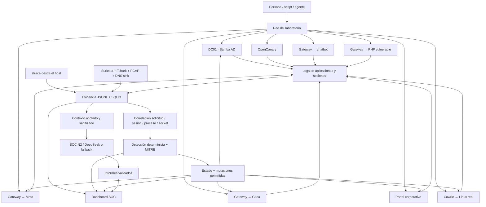
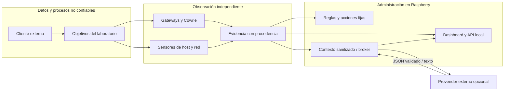
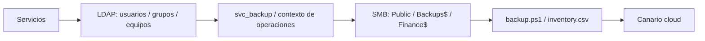
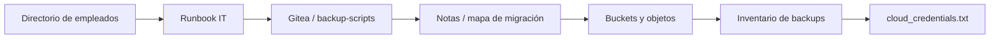
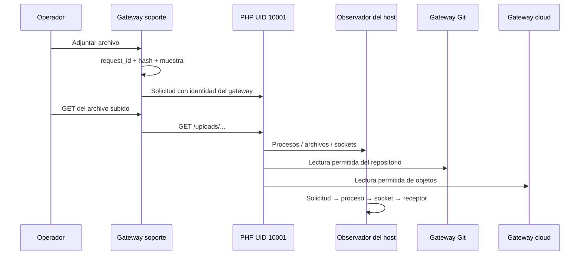
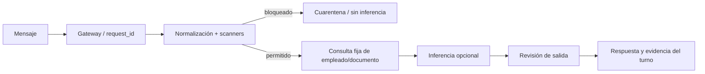
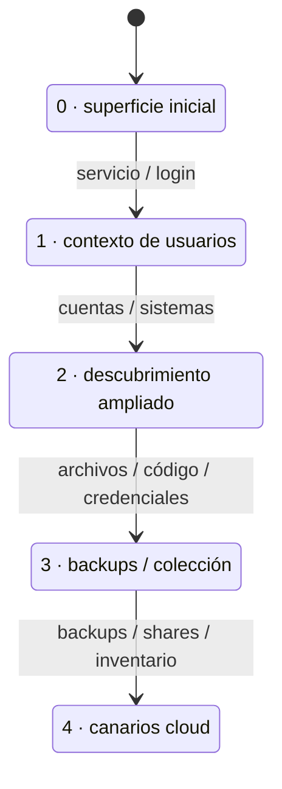
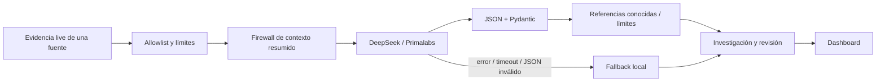

# SweetBerry

## Adaptive deception appliance · Raspberry Pi · Evidence-first SOC

**SweetBerry observa cómo un operador humano, un script o un agente ofensivo
interactúa con una empresa ficticia y adapta los señuelos para seguir su recorrido.**
Integra servicios funcionales, fachadas de protocolos, un objetivo web vulnerable,
telemetría de red y procesos, correlación de evidencias y un analista SOC N2.

El proyecto es del equipo **#EraConTUTO**. La organización representada dentro del
laboratorio es **Northstar Systems**, con dominio **CORP.LOCAL**.
Los empleados, departamentos, equipos y proyectos son datos sintéticos compartidos
entre directorio, portal, documentación y chatbot.

> **LLM proposes. Code decides.**
> El modelo redacta investigaciones e interpreta resúmenes de evidencia.
> Las reglas deterministas controlan las mutaciones del entorno.

Esta guía describe el prototipo **0.4**, su implementación y el despliegue de
referencia. Distingue lo funcional, lo emulado y lo sintético; no presenta
funcionalidades pendientes del plan original como si estuvieran implementadas.

### Contenido

- [1. Qué hace](#1-qué-hace)
- [2. Arquitectura y decisiones](#2-arquitectura-y-decisiones)
- [3. Redes y puertos](#3-redes-y-puertos)
- [4. Los catorce contenedores](#4-los-catorce-contenedores)
- [5. Servicios del host](#5-servicios-del-host)
- [6. Rutas de interacción](#6-rutas-de-interacción)
- [7. Evidencia y correlación](#7-evidencia-y-correlación)
- [8. Detección y adaptación](#8-detección-y-adaptación)
- [9. DeepSeek y SOC N2](#9-deepseek-y-soc-n2)
- [10. Chatbot y LLM Guard](#10-chatbot-y-llm-guard)
- [11. Persona, script o agente](#11-persona-script-o-agente)
- [12. Dashboard y métricas](#12-dashboard-y-métricas)
- [13. Instalación y configuración](#13-instalación-y-configuración)
- [14. Operación y contención](#14-operación-y-contención)
- [15. Replay y demostraciones](#15-replay-y-demostraciones)
- [16. API y esquemas](#16-api-y-esquemas)
- [17. Mapa del código](#17-mapa-del-código)
- [18. Validación y diagnóstico](#18-validación-y-diagnóstico)
- [19. Límites](#19-límites)
- [20. Créditos](#20-créditos)

## 1. Qué hace

SweetBerry ofrece rutas entre identidades, operaciones, código y almacenamiento
cloud emulado. El operador puede consultar usuarios, encontrar documentación,
clonar un repositorio, leer objetos S3, entrar al Linux del laboratorio o usar
el chatbot y el portal de soporte.
El valor está en relacionar esas acciones con una solicitud HTTP, una sesión SSH,
un proceso hijo, un archivo abierto, una conexión intentada o un canario leído.

Después de ciertos comportamientos, SweetBerry publica nuevos documentos,
shares, commits y objetos que amplían el recorrido observable.
La infraestructura cambia mediante reglas; el LLM explica evidencia y publica
informes sin recibir herramientas de administración.

| Capacidad | Implementación actual | Interpretación |
|---|---|---|
| Controlador de dominio | Samba AD en Docker | Protocolos reales, identidades de laboratorio |
| Linux | OpenSSH detrás de Cowrie | Shell real, usuario sin administración |
| Git corporativo | Gitea | Organización, repositorio, issues, clones y commits |
| Cloud | Moto y gateway S3/IAM/STS | APIs locales; no es una cuenta AWS |
| Protocolos adicionales | OpenCanary | Fachadas, no SQL/RDP completos |
| Soporte vulnerable | Aplicación PHP propia | Carga ejecutable dentro de un contenedor limitado |
| Chatbot | Broker privado y consultas fijas | Inferencia opcional con guardas |
| Adaptación | Reglas y estado | Funciona sin modelo |
| SOC N2 | DeepSeek/Primalabs o fallback | Informes validados, sin control del host |
| Replay | Escenarios JSON | Eventos sintéticos; no actúa sobre objetivos reales |

## 2. Arquitectura y decisiones



### Por qué existe cada capa

- **Servicios reales donde aportan recorrido:** Samba, OpenSSH, Git y S3 permiten
  usar clientes habituales y generan señales que un endpoint ficticio no aporta.
- **Fachadas para diversidad:** OpenCanary amplía la superficie sin mantener
  seis bases de datos o escritorios remotos completos.
- **Gateways independientes:** el objetivo vulnerable no debe ser el único sitio
  que conserve un registro de las interacciones que recibe.
- **Observación del host:** syscalls y ascendencia complementan logs que un
  proceso dentro del objetivo podría alterar.
- **JSONL y SQLite:** evidencia inspeccionable y consultas locales sin un SIEM,
  Elasticsearch ni base de grafos como requisito de despliegue.
- **Control determinista:** las reglas, la captura y el replay siguen operativos
  cuando el modelo falla, demora o recibe contenido adversarial.
- **Broker privado:** la clave del proveedor permanece fuera del gateway público
  y el modelo nunca recibe herramientas de shell/Docker/firewall.

### Fronteras de confianza



El contenido del atacante se conserva como evidencia, nunca como instrucciones
del host. El modelo no produce comandos ejecutables, rutas libres ni reglas de red.
Los catorce contenedores comparten el kernel de la Raspberry: no son catorce VMs.

## 3. Redes y puertos

### Entradas externas y administración

La red de referencia es **172.27.66.0/24**.
Las direcciones `.10`, `.20`, etc. son aliases del host publicados por Docker/DNAT.
Cada servicio dispone además de una dirección privada; no se necesitan ocho
interfaces físicas para presentar ocho objetivos externos diferentes.

| Dirección | Propósito | Puertos externos |
|---|---|---|
| `172.27.66.1` | Administración Raspberry | SSH `22`, dashboard `8501` |
| `127.0.0.1` | API de control | `8000`, solo loopback |
| `172.27.66.10` | `DC01` | DNS `53/1053` TCP/UDP, Kerberos `88` TCP/UDP, RPC `135`, NetBIOS `139`, LDAP `389`, SMB `445`, kpasswd `464` TCP/UDP, LDAPS `636`, GC `3268/3269`, RPC `50000–50010` |
| `172.27.66.20` | `backup01` vía Cowrie | SSH `22` → Cowrie `2222` |
| `172.27.66.30` | `intranet01` | HTTP `8088` |
| `172.27.66.40` | `git01` vía gateway | Git HTTP / UI `3000` |
| `172.27.66.50` | `cloud01` vía gateway | API AWS `4566`, compatibilidad `9080` |
| `172.27.66.60` | `services01` | FTP `2121`, MSSQL `1433`, MySQL `3306`, RDP `3389`, Redis `6379`, MongoDB `27017` |
| `172.27.66.70` | `assistant01` | HTTP `80` |
| `172.27.66.80` | `support01` | HTTP `80` |

Dashboard: **http://172.27.66.1:8501/**.
La `.1` es administración, no una entrada a la shell señuelo.
`ops/network.sh` restringe el SSH del host a `.1` y rechaza conexiones nuevas
a daemons del host mediante los aliases reservados a objetivos.

### Redes privadas y rutas permitidas

| Red | Subred | Uso |
|---|---|---|
| `sweetberry_frontend` | `172.30.67.0/24` | Servicios, gateways y componentes privados |
| `sweetberry_targets` | `172.30.66.0/24`, `internal: true` | Backend Linux y enlace Cowrie |

El broker escucha en `172.30.67.1:8001`, sobre el bridge del host.
No se publica externamente. Cowrie pertenece a ambas redes y su IP no está
fijada por Compose; no debe asumirse una dirección estable para ese contenedor.

| Origen privado | Destino permitido | Motivo |
|---|---|---|
| `172.30.67.42` | `172.30.67.40:3000` | Gateway Git → Gitea |
| `172.30.67.50` | `172.30.67.51:5000` | Gateway cloud → Moto |
| `172.30.67.81` | `172.30.67.80:8080` | Gateway soporte → PHP |
| `172.30.67.80` | `172.30.67.42:8080` | Recorrido controlado soporte → Git |
| `172.30.67.80` | `172.30.67.50:8080` | Recorrido controlado soporte → cloud |
| `172.30.67.70` | `172.30.67.1:8001` | Gateway chatbot → broker |
| Frontend | `172.30.67.53:53` TCP/UDP | DNS local sin reenvío a Internet |

`ops/guard.sh` permite respuestas a conexiones establecidas, aplica controles
en `DOCKER-USER` y rechaza otras conexiones nuevas desde frontend.
También restringe acceso de redes Docker al host; el host mantiene acceso al proveedor.
El DNS local responde NXDOMAIN a nombres desconocidos y registra la pregunta.

Los aliases externos no proporcionan un recorrido hairpin fiable desde soporte.
Su archivo `/srv/corp/operations.txt` documenta los endpoints internos permitidos:

```text
Git:   http://172.30.67.42:8080/northstar/backup-scripts.git
Cloud: http://172.30.67.50:8080
```

## 4. Los catorce contenedores

La especificación ejecutable está en [compose.yaml](compose.yaml).

| Servicio Compose | IP privada | Qué ejecuta y por qué existe |
|---|---|---|
| `dc` | `172.30.67.10` | Samba AD: identidades, DNS, LDAP, Kerberos y shares reales |
| `linux` | `172.30.66.20` | OpenSSH/Debian: shell funcional y archivos corporativos señuelo |
| `cowrie` | Dinámica, dos redes | Proxy SSH: grabación de sesión y enlace cliente/backend |
| `portal` | `172.30.67.30` | Portal Python propio: empleados y documentos que conectan rutas |
| `forge` | `172.30.67.40` | Gitea rootless: organización, repo, issues y commits adaptativos |
| `forge-edge` | `172.30.67.42` | Gateway propio: evidencia HTTP/Git independiente del servicio |
| `cloud` | `172.30.67.51` | Moto: objetos S3 y fixtures IAM/STS sin cuenta AWS |
| `cloud-edge` | `172.30.67.50` | Gateway propio: evidencia cloud y operaciones permitidas de lectura |
| `canary` | `172.30.67.60` | OpenCanary: fachadas de protocolos y contactos/autenticaciones |
| `chatbot` | `172.30.67.70` | Gateway propio: entrada del asistente, token limitado y request IDs |
| `guard` | `172.30.67.71` | Protect AI LLM Guard: scanners privados separados de inferencia |
| `webtrap` | `172.30.67.80` | PHP propio: carga ejecutable y ejecución sin privilegios |
| `webedge` | `172.30.67.81` | Gateway propio: solicitudes, respuestas, hashes y cuarentena independiente |
| `dns` | `172.30.67.53` / `172.30.66.53` | DNS sink propio: resolución local y evidencia de destinos intentados |

### Identidad corporativa y AD

[infra/company.json](infra/company.json) comparte empleados, departamentos,
grupos, equipos y proyectos entre servicios. `SQL01`, `FILES01` y `BUILD01`
son objetos/contexto del dominio, no tres contenedores adicionales completos.
Samba se aprovisiona como realm `CORP.LOCAL`, dominio `CORP`, hostname `dc01`.
Su estado se conserva en volúmenes durante reinicios normales.

`analyst` es la cuenta de interacción controlada. La mutación `expose_users`
crea/actualiza `svc_backup`. Las rutas pueden incluir `Public`, `Backups$`
y `Finance$`, además de los shares propios de AD.
Scripts fijos y recarga de configuración materializan los cambios.
No hay AD CS ni KDC/LDAP caseros. La variante AS-REP no desactiva
preautenticación en el DC para ejecutar esa historia en vivo.

### Linux y Cowrie

El cliente conecta a `.20:22`; Cowrie registra y conduce la sesión al Linux privado.
`analyst` recibe una shell real. El backend deshabilita root login y forwarding SSH.
No es el SSH administrativo de la Raspberry.
Los archivos de operaciones apuntan a recursos sintéticos del laboratorio.

### Gitea y Moto

Gitea aloja `northstar/backup-scripts`, con historial e issues reales.
Las mutaciones publican documentos y commits que se pueden verificar después.
El gateway registra también las solicitudes del protocolo Git HTTP.
Moto aloja el bucket `corp-backups` y objetos reales dentro del emulador.
Su lectura anónima es una configuración intencional del laboratorio.
Los fixtures IAM describen cuentas/políticas; **no implementan autorización IAM completa**.
No se requiere token, facturación ni cuenta AWS.

### Soporte vulnerable

`webtrap` acepta adjuntos sin bloquear PHP y sirve el directorio `/uploads/`.
Solicitar un archivo ejecutable puede ejecutar código como **UID 10001** dentro
del contenedor. El objetivo es observar acciones posteriores al acceso.
El gateway calcula SHA-256 y conserva muestras fuera de ese filesystem.
La traza PHP es `application-untrusted` y se complementa con observación del host.
No se ejecuta malware automáticamente durante el arranque.

## 5. Servicios del host

| Unidad systemd | Responsabilidad | Por qué está fuera de los objetivos |
|---|---|---|
| `sweetberry-infra` | Aliases, políticas, Compose e inicialización | Preparar controles antes/después de publicar servicios |
| `sweetberry-api` | Sensores, cola, índice, correlación, reglas y SOC N2 | Mantener el plano de control independiente |
| `sweetberry-dashboard` | Frontend y proxy administrativo acotado | Mantener el token de API fuera del navegador |
| `sweetberry-chat-broker` | Herramientas fijas, guardas, inferencia y límites | Mantener la clave del proveedor fuera del gateway público |
| `sweetberry-network-sensor` | Suricata AF_PACKET de alcance restringido | Observar interfaz y bridges desde el host |
| `sweetberry-pcap` | tcpdump circular | Retener paquetes para revisión con presupuesto de disco |

Se generan mediante `ops/install-services.sh` y `ops/install-network-sensor.sh`.
Los bridges Docker se descubren al iniciar; no se depende de IDs que cambien
cuando un reset recrea las redes.

## 6. Rutas de interacción

Son hipótesis de recorrido, no secuencias obligatorias ni prueba de explotación.
El dashboard debe representar lo observado, no completar pasos por existir
una flecha en el diagrama.

### A · Identidad → operaciones → backups



Se observa el paso desde enumeración a archivos de operaciones y credenciales.
Samba proporciona datos reales del laboratorio; las reglas deciden cuándo
añadir contexto, shares y documentos. Autenticación, accesos SMB y metadatos
de protocolo aportan evidencias complementarias.
**La variante AS-REP es de replay**: su señuelo sintético no demuestra una
vulnerabilidad AS-REP en el controlador real.

### B · Portal → Git → cloud



Representa interés en DevOps y contexto empresarial. No necesita una explotación
para dejar señales de descubrimiento, colección de código y lectura de objetos.
Consultar repositorios puede publicar notas; consultar buckets expone inventario;
leer inventario puede publicar el siguiente canario.

### C · Linux → descubrimiento → archivos

```mermaid
flowchart LR
    A[SSH .20:22] --> B[Cowrie: sesión]
    B --> C[Shell analyst en backup01]
    C --> D[Identidad / host / procesos / red]
    D --> E[/srv/corp / Backups]
    E --> F[Inventario / referencias Git-cloud]
```

Se observa qué consulta el operador, qué archivos abre, qué procesos crea y
a dónde intenta conectarse. Cowrie conserva sesión; strace observa descendientes.
El monitor de integridad muestra cambios de archivos del entorno sin asignarlos
automáticamente a un atacante.

### D · Carga web → ejecución → pivot permitido



Se intenta vincular la solicitud externa con el proceso y sus llamadas posteriores
a Git/cloud. El gateway reemplaza headers de identidad proporcionados por el cliente:
`X-Forwarded-For` y `X-SweetBerry-Request-ID` no se aceptan como atribución fiable.
Las conexiones externas del objetivo se bloquean; DNS y `connect()` desconocidos
son intentos observados, **no C2 confirmado ni comunicación exitosa**.

### E · Chatbot → consulta permitida → intento de manipulación



Se observa uso normal e intentos de alterar instrucciones, obtener configuración
o inducir acciones fuera de las herramientas permitidas.
Chatbot y SOC N2 no comparten un agente con herramientas de shell.

## 7. Evidencia y correlación

### Fuentes complementarias

| Capa | Datos | Límite |
|---|---|---|
| Red | Flows, alertas, DNS, HTTP, TLS, SSH/SMB, archivos y PCAP | Capturar paquetes no descifra contenido cifrado |
| Host | Ejecuciones, forks, aperturas, renombres, borrados y sockets | Un proceso muy corto anterior al attach puede perderse |
| Aplicación | Gateways, Cowrie, Samba, broker, DNS y stdout | El log de un objetivo comprometido no es prueba independiente |

Suricata funciona como **IDS pasivo**, no IPS. La configuración incluye reglas
locales de ráfagas SYN y contacto con carga de archivos, y tipos EVE seleccionados.
No se afirma cobertura completa de exploits ni un ruleset comercial.
Tshark aporta metadatos seleccionados al normalizador.
El DNS sink registra preguntas y no las reenvía a Internet.

### Ubicación bajo `runtime/`

| Ruta | Contenido |
|---|---|
| `collector/events.jsonl` | Señales normalizadas, decisiones y mutaciones |
| `collector/state.json` | Estado persistido del motor |
| `collector/observer.jsonl` | Monitor de procesos y conexiones |
| `collector/soc_reports.jsonl` | Informes del modelo y fallbacks |
| `telemetry/evidence-*.jsonl` | Segmentos de evidencia estructurada |
| `telemetry/index.sqlite` | Índice WAL, cursores, canarios e investigaciones |
| `cowrie/` | Logs, TTY y artefactos propios del proxy SSH |
| `dc/` | Auditoría de autenticación y archivos Samba |
| `portal/`, `forge/`, `cloud/`, `webedge/`, `chatbot/` | Logs de aplicaciones/gateways |
| `webedge/quarantine/` | Muestras identificadas por hash |
| `broker/` | Turnos, guardas, consultas y respuestas |
| `network/` | EVE JSON, reglas y configuración generada |
| `pcap/` | Anillo de paquetes |
| `archive/` | Evidencia archivada por reset |
| `previews/` | Capturas de QA visual |

### Procedencia y enlaces

La evidencia incluye `event_id`, timestamp, sensor, asset, kind, modo y confianza.
Se referencia el segmento JSONL y su offset para localizar el registro original.
El índice añade correlación derivada sin reescribir la observación del segmento.
Puede contener `request_id`, `process_key`, `parent_process_key`, `canary_id`,
destino/puerto y vínculo con otra solicitud.

1. **SSH:** se cruza el socket backend informado por Cowrie con la conexión
   aceptada y la ascendencia de procesos del Linux.
2. **Web:** request ID del gateway, intervalo PHP y descendencia de proceso
   permiten atribuir actividad a una solicitud.
3. **Pivot:** la tupla local del socket se cruza con el puerto cliente del gateway
   receptor para conservar la solicitud/fuente de origen.
4. **Evidencia tardía:** un worker revisa relaciones pendientes y actualiza el índice.

La identidad de proceso contiene **boot ID + contenedor + PID host + ticks de inicio**.
Se traducen namespaces PID y se unen syscalls `unfinished/resumed`.
La fase y resultado distinguen intentos de observaciones completadas.
Si faltan piezas, queda sin atribuir: compartir IP o timestamp no prueba autoría.
`observed_source_ip` conserva la fuente inicialmente observada al añadir la derivada.

### Retención, truncamiento y privacidad

| Recurso | Comportamiento actual |
|---|---|
| Segmentos de evidencia | Unos 64 MiB por segmento y unas 4 GiB retenidas |
| Índice SQLite | Conserva metadatos; no tiene la misma cuota que los segmentos |
| PCAP | Ocho archivos de 128 MB, aproximadamente 1 GB |
| Cuerpo HTTP registrado | Primeros 64 KiB, con señal de truncamiento |
| Respuesta upstream | Hasta 8 MiB en proxy; primeros 64 KiB en evidencia |
| Muestras subidas | Hasta 5 MiB por muestra y 256 MiB en cuarentena |
| Stdout Docker | Cuatro archivos de 16 MB por contenedor |
| Archivos archivados | Persisten hasta gestión explícita del operador |

No existe una cuota global para todo `runtime/`. Índice, logs y archivos archivados
requieren mantenimiento. Una referencia puede permanecer aunque su segmento
haya expirado; la consulta expone disponibilidad del registro original.
Se redactan campos sensibles conocidos y argumentos acotados, sin garantizar
eliminar todo secreto arbitrario incrustado en texto libre.
Sesiones, cuerpos y muestras siguen siendo material sensible de laboratorio.
`.env`, `runtime/`, capturas y claves privadas se excluyen del repositorio.
Los filtros PCAP excluyen administración, broker privado y ruta de inferencia.
En live se envía al proveedor solo el contexto seleccionado para cada uso.
SOC N2 recibe resúmenes sanitizados; el chatbot sí envía al proveedor el mensaje
del usuario que haya superado el guard, junto con el contexto público permitido.
No son dos flujos de datos idénticos ni se promete que toda inferencia permanezca local.

## 8. Detección y adaptación

`app/state.py` mantiene sesiones, mundo y persistencia; `app/event_bus.py`
desacopla sensores y procesamiento. `app/mitre.py` define las reglas.
Las acciones desconocidas se conservan sin inventar una técnica ATT&CK.

### Riesgo y MITRE

El riesgo suma hasta 100 y se puntúa una vez por **acción normalizada + host**
en la sesión. Las repeticiones quedan registradas sin sumar indefinidamente.
Un riesgo 100 no significa probabilidad 100% de compromiso.

| Señal | ATT&CK | Riesgo base | Interpretación |
|---|---|---:|---|
| `portscan` | T1046 | 15 | Descubrimiento de servicios |
| `ldap_users` | T1087.002 | 20 | Cuentas de dominio |
| `ldap_groups` | T1069.002 | 15 | Grupos de dominio |
| `ldap_computers` | T1018 | 15 | Consulta de equipos |
| `asrep_request` | T1558.004 | 45 | Storyline potencial sintético de replay |
| `enumerate_shares` | T1135 | 20 | Recursos compartidos |
| `ssh_login` | T1078 | 20 | Login válido del laboratorio |
| `system_discovery` | T1082 | 15 | Identidad/host |
| `file_discovery` | T1083 | 15 | Descubrimiento de archivos |
| `network_discovery` | T1016 | 10 | Configuración de red |
| `process_discovery` | T1057 | 10 | Procesos |
| `repo_read` | T1213.003 | 25 | Código en repositorios |
| `cloud_buckets` | T1619 | 15 | Almacenamiento cloud |
| `cloud_inventory_read` | T1530 | 25 | Inventario sintético |
| `cloud_object_read` | T1530 | 20 | Lectura de objetos |
| `cloud_account_discovery` | T1087.004 | 15 | Identidades cloud emuladas |
| `secret_access` | T1552.001 | 40 | Archivo canario |
| `web_upload` | T1105 | 15 | Transferencia hacia uploads |
| `web_script_request` | T1505.003 | 30 | Script subido solicitado; señal potencial |
| `web_command_execution` | T1059 | 35 | Ejecución observada y correlacionada |
| `password_spray_pattern` | T1110.003 | 25 | Patrón potencial de múltiples cuentas |
| `prompt_injection` | Sin ID forzado | 20 | Entrada en cuarentena |

La lista completa está en [app/mitre.py](app/mitre.py).
Los mapeos describen comportamiento compatible con técnicas; una transferencia
o una lectura no demuestran por sí solas una intrusión exitosa.

### Estado y cambios permitidos



El nivel usa `max(nivel_actual, nivel_de_regla)`: puede saltar niveles.
El diagrama resume progresión y no prueba una cadena de explotación.

| Disparador | Mutación | Resultado |
|---|---|---|
| Nivel ≥ 1 | `expose_users` | Cuenta/contexto señuelo de usuarios |
| Nivel ≥ 3 | `expose_backup_share` | `Backups$`, documentación e inventario |
| Nivel ≥ 4 | `expose_cloud_credential` | Archivo/objeto canario inerte |
| `ldap_groups` | `expose_finance_share` | Share/documentos Finance |
| `ldap_computers` | `expose_sql_note` | Nota de operaciones SQL |
| `web_directory` / `system_discovery` | `expose_it_runbook` | Documento que conecta rutas |
| `repo_discovery` | `expose_repository_notes` | Nuevas notas en Gitea |
| `repo_read` | `expose_cloud_map` | Mapa de migración |
| `cloud_buckets` | `expose_cloud_inventory` | Inventario publicado en Moto |
| `cloud_inventory_read` | `expose_cloud_credential` | Siguiente canario cloud |

Se registra trigger, timestamp, resultado por servicio y éxito/error.
No se repite una mutación exitosa por cada cliente.
En live los cambios afectan al entorno compartido, no a infraestructura privada
por atacante. En replay se registran como simulados sin llamar al actor real.
Los canarios usan marcadores `SWEETBERRY_CANARY_DECOY` y no son claves productivas.

## 9. DeepSeek y SOC N2

`app/soc_n2.py` utiliza Primalabs con API de chat completions.
El modelo de referencia es `primalabs-ai/DeepSeek-V4.1-Flash-1017`;
la detección no depende de ese nombre ni de su disponibilidad.

**Capacidades:** consultar vistas acotadas y sanitizadas de una fuente,
interpretar acciones/familias de procesos, publicar informes y hallazgos,
actualizar investigaciones y referenciar IDs de evidencia conocidos.
Puede evaluar prudentemente el estilo de interacción del operador.

**Límites:** no recibe cuerpos HTTP arbitrarios, prompts crudos del atacante,
comandos/argv completos, contraseñas o claves de administración.
Los ejecutables se transforman a familias permitidas cuando procede.
No tiene shell, SQL libre, Docker, firewall, navegación arbitraria o rutas libres.
Solo escribe estructuras de informe aceptadas por la aplicación.



El esquema incluye título, resumen, severidad, confianza, hallazgos con
`evidence_ids`, recomendaciones, incertidumbres y evaluación opcional del operador.
Se rechazan campos inesperados, referencias desconocidas y valores fuera de límites.
El worker serializa llamadas y espera aproximadamente 20 segundos entre ciclos.
Analiza fuentes con contexto cambiado o una solicitud explícita de análisis.
Las investigaciones se agrupan por fuente con ventana de inactividad de 30 minutos.

`LLM_MODE=mock` publica resúmenes locales sin llamadas al proveedor.
Fallas de red, credencial, JSON o validación activan fallback identificado.
Se muestra tipo de error sin publicar tokens o cuerpos privados del proveedor.
Replay no se presenta al analista como si fuera evidencia de acciones live.

## 10. Chatbot y LLM Guard

Es una superficie distinta del analista SOC N2. El gateway público conoce un
token limitado de broker, no la clave Primalabs ni el token administrativo.
El broker valida token y origen esperado de la red privada.

El guard usa **Protect AI LLM Guard 0.3.16** y el modelo público
`protectai/deberta-v3-base-prompt-injection-v2`, CPU y Python 3.12.
Es un clasificador de seguridad local, no un LLM generativo alojado en la Pi.

| Etapa | Función |
|---|---|
| Normalización | NFKC y eliminación de caracteres de formato invisibles |
| `BanSubstrings` | Patrones explícitos en inglés/español |
| `Secrets` | Scanner de posibles secretos |
| `PromptInjection` | Clasificación de entrada, umbral `0.65` |
| Política de salida | Scanners y nombres de configuración privada |

Entrada y salida no ejecutan exactamente la misma secuencia: el clasificador
de prompt injection se utiliza para entrada; salida aplica la política implementada
en [infra/guard/server.py](infra/guard/server.py).
El broker elige una consulta fija por turno: `lookup_employee` o
`read_public_document`. No hay herramientas arbitrarias ni renderizado de HTML
generado por el modelo.
Se limitan solicitudes a 20/minuto/fuente y llamadas al proveedor a 6/minuto
globales, con inferencia serializada.

Si el guard requerido no está listo, no se llama al modelo y se utiliza respuesta
local identificada. Un healthcheck HTTP saludable no demuestra classifier listo:
se expone además su estado de carga/disponibilidad.
Esta protección por capas no garantiza bloquear toda forma de prompt injection.

## 11. Persona, script o agente

`app/behavior.py` estima **estilo observable**, no identidad real del operador.

| Etiqueta | Lectura |
|---|---|
| `insufficient_evidence` | Faltan interacciones independientes |
| `human_like` | Pausas y variabilidad compatibles con interacción manual |
| `automation_like` | Velocidad, regularidad/amplitud compatibles con scripts |
| `agent_compatible` | Recuperación ante errores y señales de automatización |

Se excluyen mantenimiento, recursos estáticos y entradas bloqueadas; se deduplican
solicitudes y se observan servicios, acciones, mediana de retrasos, variabilidad,
pausas y cambios de objetivo tras errores.
Se requieren **seis interacciones independientes** antes de clasificar.
Un User-Agent de agente es autodeclarado y falsificable; un script puede parecer
agente y una persona puede usar herramientas automatizadas.
La confianza heurística se limita a **0.70**, también para la evaluación LLM.
Sin evidencia válida o mínimo suficiente, la evaluación del modelo se fuerza a
evidencia insuficiente. No es una probabilidad calibrada de presencia de IA.

## 12. Dashboard y métricas

El frontend principal es HTML/CSS/JavaScript servido por FastAPI.
`dashboard/dashboard.py` conserva una alternativa Streamlit heredada;
el launcher utiliza `dashboard/server.py`.
El proxy limitado mantiene el token administrativo fuera del navegador.

### Cómo leer el overview operativo

La vista responde cuatro preguntas: **quién interactúa, qué busca, qué evidencia
existe y cómo respondió SweetBerry**. El modo seleccionado indica si se observan
sesiones live, fixtures replay o ambos; replay se identifica como sintético.
El tema visual ofrece modo oscuro por defecto y alternativa clara. La tipografía
pixelada se reserva al nombre de producto junto al logo; las investigaciones y
tablas utilizan tipografía de lectura.

| KPI / gráfico | Qué mide y qué no debe inferirse |
|---|---|
| IPs de origen externas | Direcciones observadas fuera de redes internas; no identidades/personas únicas |
| Objetivos contactados | Hosts de la superficie de ocho objetivos con señales en el alcance |
| Riesgo máximo `/100` | Mayor puntuación determinista de sesión, no probabilidad de compromiso |
| Ejecuciones web verificadas | Señales de ejecución con correlación solicitud/proceso, no simples GET a `.php` |
| Lecturas confirmadas de canarios | Interacciones marcadas como confirmadas, no todos los intentos |
| Entradas en cuarentena | Señales bloqueadas por la frontera de razonamiento |
| Estado global del appliance | Contenedores saludables, evidencia indexada y salud de guard/captura; no depende de una única sesión |
| Grupos de comportamiento | Contacto, descubrimiento, acceso/ejecución, datos y guardas; no prueba una cadena causal |
| Ranking de objetivos | Distribución de señales por objetivo, no vulnerabilidades descubiertas |
| Distribución de evidencia | Fuerza/estado declarado de las observaciones, no un veredicto automático de intrusión |
| Actividad temporal | Volumen de eventos normalizados en la ventana cargada, no paquetes por segundo |

Los gráficos de actividad utilizan la ventana de eventos canónicos cargada por
la UI; el total de evidencia bruta indexada se muestra por separado como dato
global. Cambiar de fuente o alcance no convierte esos dos universos en la misma
métrica. Un evento puede generar varios registros de evidencia de distintos sensores.

| Vista | Pregunta que ayuda a responder |
|---|---|
| Overview | ¿Qué fuentes, objetivos, señales y respuestas se observan? |
| Event explorer | ¿Qué ocurrió, cuándo y con qué evidencia? |
| Attack paths | ¿Qué secuencia de técnicas se reconstruye desde eventos? |
| Deception assets | ¿Qué servicio/fachada existe y en qué estado está? |
| Threat intelligence | ¿Qué IPs, dominios, hashes y canarios se observaron? |
| Session evidence | ¿Qué comandos, procesos, conexiones y cambios quedaron registrados? |
| Telemetry & tracing | ¿Qué evidencia y correlación sostienen la observación? |
| AI defense | ¿Qué pasó en cada turno, scanner, herramienta y respuesta? |
| SOC N2 | ¿Qué informe, hallazgos e incertidumbres se publicaron? |
| Replay lab | ¿Cómo funciona una ruta reproducible sin acciones live? |

Inteligencia resume observaciones locales recientes, sin inventar reputación,
geolocalización o atribución de actores. Señales no equivalen a ataques únicos;
canario leído no equivale a credencial real robada; ATT&CK no prueba explotación.
La UI permite filtros por fuente, asset, kind, proceso, solicitud y canario,
paginación estable con timestamp/ID y exportaciones JSON/CSV de alcance indicado.
Los registros rutinarios siguen indexados aunque no estén en la vista principal.
Fuentes y recursos de marca se sirven localmente, sin CDN requerido.

**Acceso:** el panel se apoya en restringir acceso a la red administrativa.
No implementa cuentas, MFA ni RBAC. El token de la API no debe confundirse
con autenticación individual del dashboard.

## 13. Instalación y configuración

### Entorno y requisitos

Despliegue verificado: Raspberry Pi de 8 GB, Kali ARM64, Python 3.14.7,
Docker Engine 28.5.2 y Compose 2.40.3. El núcleo requiere **Python 3.11+**;
el guard usa Python 3.12 separado.
Raspberry Pi OS ARM64 es objetivo de portabilidad, no una validación equivalente
al sistema Kali que se probó realmente.

Requiere Docker/Compose v2, `strace`, `tshark`, `suricata`, `tcpdump`,
`iptables`, NetworkManager, `sshd`, Python/venv y PyYAML del sistema.
El launcher no instala todas las herramientas del host ni configura la red física.
Los scripts suponen `wlan0`, perfil `kali-mgmt-ap` y `172.27.66.1/24`.
DHCP se reserva en `.100–.254`; las direcciones bajas quedan para objetivos.
Varias rutas y direcciones son específicas: cambiar `LAB_IP` no migra todo.

```sh
git clone https://github.com/Suredials/SWEET-BERRY.git sweetberry
cd sweetberry
python3 scripts/configure.py
sh run.sh
```

El launcher prepara venv, dependencias, carpetas, aliases, firewall, imágenes,
cache, Compose y unidades. La inicialización siembra AD, Gitea y Moto.
La ruta de referencia es `/home/suredials/sweetberry`.

### Variables

| Variable | Uso |
|---|---|
| `LAB_IP` | Administración, `172.27.66.1` |
| `CAPTURE_INTERFACE` | Sensor de protocolo, `wlan0` |
| `DOMAIN_PASSWORD` | Clave aleatoria de administración AD de laboratorio |
| `BAIT_PASSWORD` | Clave claramente marcada de cuenta señuelo |
| `ADMIN_TOKEN` | Token privado de control |
| `CHAT_BROKER_TOKEN` | Token privado gateway/broker |
| `GITEA_ADMIN_PASSWORD` | Clave administrativa generada |
| `LLM_MODE` | `mock` por defecto; `live` para proveedor |
| `LLM_PROVIDER` | `primalabs`, no un selector universal de proveedores |
| `LLM_MODEL` | Nombre de modelo del proveedor |
| `PRIMALABS_API_KEY` | Clave privada fuera de código/navegador |
| `SWEETBERRY_OFFLINE` | Launcher Linux sin infraestructura real |
| `SWEETBERRY_LIVE` | Activar sensores y actor al crear la API |
| `SWEETBERRY_BUILD` | Recompilar imágenes cuando sea `true` |
| `SWEETBERRY_API_URL` | Destino del proxy, normalmente loopback `8000` |

Compose acepta overrides parciales `DC_IP`, `COWRIE_IP`, `PORTAL_IP`,
`FORGE_IP`, `CLOUD_IP`, `CANARY_IP`. No todos los módulos los utilizan.
`scripts/configure.py` crea claves aleatorias al crear `.env` y agrega variables
privadas faltantes. No copiar placeholders `GENERATE_WITH_scripts_configure_py`
de `.env.example` como contraseñas finales. Mantener `.env` con permisos `600`.

```dotenv
LLM_MODE=mock
LLM_PROVIDER=primalabs
LLM_MODEL=primalabs-ai/DeepSeek-V4.1-Flash-1017
PRIMALABS_API_KEY=
```

`ops/configure-provider.py` solicita la clave sin eco y escribe por SFTP.
Reiniciar API y broker para cargar cambios. No imprimir `.env` ni pasar claves
por argumentos de shell o guardarlas en Git.

La primera preparación descarga pesos públicos del guard; necesita red/espacio.
El volumen externo `sweetberry_guard-cache` sobrevive al reset y permite cargar
con `HF_HUB_OFFLINE=1`. Sin Internet no hay inferencia remota; reglas/captura/replay
continúan. Construir imágenes sin dependencias descargadas sí necesita red.

### Desarrollo local

```powershell
./run.ps1
```

```sh
SWEETBERRY_OFFLINE=true sh run.sh
```

UI: `http://127.0.0.1:8501`; API: loopback `8000`.
Este modo ofrece mock/replay, sin levantar DC, Linux, Gitea, Moto ni sensores.

## 14. Operación y contención

```sh
sh run.sh
SWEETBERRY_BUILD=true sh run.sh
sudo docker compose ps --all
systemctl is-active sweetberry-api sweetberry-dashboard sweetberry-chat-broker
sudo journalctl -u sweetberry-api -n 50 --no-pager
```

Reiniciar contenedor, unidad, hacer reset y reiniciar el sistema son acciones
distintas. Un reinicio normal conserva volúmenes, evidencia y estado.
Las unidades habilitadas preparan el sistema después del boot; el SSH administrativo
espera red y reintenta si falla el bind.

```sh
sh reset_demo.sh
```

Reset detiene colectores/sensores, archiva evidencia, recrea volúmenes de objetivos,
inicia infraestructura y siembra estado inicial. Conserva `.env`, claves
administrativas y cache externo del guard. Los breadcrumbs vuelven al inicio.
Comprueba la ruta de referencia antes de sus operaciones destructivas.
No equivale a limpiar únicamente replay desde el panel.

| Control del objetivo web | Implementación |
|---|---|
| Usuario | UID 10001, sin administración del host |
| Filesystem | Raíz de solo lectura |
| Privilegios | Capabilities eliminadas, `no-new-privileges` |
| Procesos / CPU | 16 PIDs y 0.75 CPU |
| Temporal | `/tmp` tmpfs de 64 MiB |
| Proceso / archivo | Espacio virtual heredado de 128 MiB; archivo de hasta 10 MiB |
| Uploads | Watchdog detiene objetivo al superar 128 MiB o 256 archivos |
| Montajes | Sin socket Docker ni carpetas administrativas del host |
| Red | Solo DNS local y recorridos Git/cloud permitidos |

El kernel verificado no tiene memory cgroups utilizables: los `mem_limit`
de Compose **no son efectivos en ese kernel**. El límite por proceso no es
una cuota global de RAM. Los contenedores comparten kernel y no proporcionan
una frontera absoluta frente a vulnerabilidades del host.

## 15. Replay y demostraciones

| Escenario | Historia |
|---|---|
| `replay_full_attack` | Servicios, identidad, AS-REP potencial, shares, canarios y firewall |
| `domain_recon` | Usuarios, grupos, equipos y Finance |
| `linux_operator` | Descubrimiento y archivos desde una sesión |
| `devops_pivot` | Portal → repositorio → migración → objetos |
| `cloud_trail` | Buckets, inventario y canario |
| `prompt_guard` | Contexto benigno e instrucciones sospechosas |
| `multi_vector` | Rutas de varias fuentes sintéticas |
| `authentication_pattern` | Fallos sintéticos y patrón potencial de spray |
| `service_sweep` | Contactos de protocolos |
| `demo_asrep`, `demo_smb`, `demo_cloud` | Extractos de presentación |

Timestamps e IPs son fixtures; se utiliza `192.0.2.0/24`.
Replay no genera tráfico ofensivo, autentica cuentas, sube archivos ni modifica
objetivos reales. Es reproducible y no depende del proveedor.

```sh
python scripts/replay.py scenarios/replay_full_attack.json
```

Ese script imprime resultados locales. El botón de Replay lab utiliza la API
y actualiza el panel. Limpiar replay conserva sesiones/evidencia live.

```sh
python -m pip install -r requirements-demo.txt
python scripts/live_ad.py
python scripts/live_devops.py
python scripts/live_linux.py
```

Login Linux de laboratorio: `analyst / SWEETBERRY_CANARY_DECOY_LabOnly!`.
No es la clave de la Raspberry ni la administrativa de AD.

```sh
ssh analyst@172.27.66.20
git clone http://172.27.66.40:3000/northstar/backup-scripts.git
curl http://172.27.66.50:4566/
```

`check_full_chain.py` utiliza una fixture PHP de comandos fijos e inocuos:
identidad y lecturas Git/cloud. Verifica hash, ejecución sin privilegios,
reemplazo de headers y enlace solicitud → proceso → socket → receptor.
No ejecuta el adjunto en el host administrativo ni instala malware.

## 16. API y esquemas

La API live escucha solo en loopback. Excepto `/health`, las rutas de control
exigen `X-Admin-Token`. Sus cuerpos se limitan a 16 KiB; los límites de uploads
son distintos y pertenecen a los gateways de objetivos.

| Método / ruta | Función |
|---|---|
| `GET /health` | Versión, modo, cola y estado de sensores |
| `GET /state` | Sesiones, mundo, assets, replay, SOC y cobertura |
| `GET /events` | Eventos canónicos retenidos |
| `POST /events` | Ingesta de desarrollo, rechazada en live |
| `GET /telemetry` | Consulta de hasta 300 filas |
| `GET /telemetry/{event_id}` | Registro y referencia original |
| `GET /incidents` | Investigaciones/revisiones |
| `GET /intel` | Observables locales |
| `GET /transcripts` | Comandos SSH registrados |
| `POST /soc/analyze` | Solicitar análisis live |
| `POST /replay` | Ejecutar un escenario permitido |
| `POST /reset-replay` | Detener/limpiar replay |

Filtros: `source`, `asset`, `kind`, `process_key`, `request_id`, `canary_id`,
`limit`, `before`, `before_id`, `important`. No hay SQL libre.
El frontend usa `/api/...` para operaciones permitidas contra la API privada.

Evento normalizado de entrada:

```json
{
  "timestamp": 1761910000,
  "session_id": "live:192.0.2.42",
  "source_ip": "192.0.2.42",
  "sensor": "forge",
  "target_host": "git01",
  "action": "repo_read",
  "target": "/northstar/backup-scripts",
  "metadata": {"request_id": "example-id", "evidence": "confirmed"}
}
```

El motor añade técnica, categoría, secuencia, riesgo base/otorgado y decisión.
La evidencia es más amplia e incorpora procedencia y correlación:

```json
{
  "event_id": "example-evidence-id",
  "timestamp": 1761910000,
  "sensor": "host-strace",
  "asset": "webtrap",
  "kind": "process_exec",
  "source_ip": "unattributed",
  "mode": "live",
  "trust": "host-syscall",
  "process_key": "boot:container:pid:startticks",
  "syscall_phase": "complete",
  "evidence_ref": {"file": "evidence-example.jsonl", "offset": 0}
}
```

## 17. Mapa del código

| Ruta | Responsabilidad |
|---|---|
| `app/api.py` | Lifecycle, API y conexiones entre módulos |
| `app/models.py` | Esquemas de eventos/replay |
| `app/state.py` | Mundo/sesiones, scoring, decisiones y persistencia |
| `app/event_bus.py` | Cola y worker |
| `app/sensors.py` | Normalización de logs/metadatos de protocolo |
| `app/detector.py`, `app/mitre.py` | Aliases, reglas y ATT&CK |
| `app/deception.py` | Plan y actor de acciones permitidas |
| `app/lab_services.py` | Cambios funcionales Gitea/Moto |
| `app/llm_firewall.py` | Filtro determinista de contexto |
| `app/llm_reasoner.py` | Evaluación local de sesión y esquema de recomendación |
| `app/soc_n2.py` | Informes live, validación y fallback |
| `app/chat_broker.py` | Guardas, consultas y proveedor del chatbot |
| `app/behavior.py` | Perfil heurístico de operador |
| `app/observer.py` | strace, parsing, procesos y sockets |
| `app/evidence_reader.py` | Lectores, stdout y cursores |
| `app/correlation.py` | Enlaces SSH/HTTP/proceso/conexión |
| `app/telemetry.py` | JSONL, índice, canarios e investigaciones |
| `app/coverage.py` | Salud, disco y watchdog |
| `app/intel.py` | Inventario e inteligencia local |
| `app/replay.py`, `scenarios/` | Catálogo y fixtures |
| `dashboard/server.py`, `dashboard/static/` | Frontend/proxy, gráficos y marca |
| `dashboard/dashboard.py` | Streamlit heredado, fuera del launcher principal |
| `infra/company.json` | Empresa ficticia compartida |
| `infra/dc/`, `infra/linux/` | Imágenes, siembra y mutaciones |
| `infra/cowrie/`, `infra/canary/` | Configuración de proyectos upstream |
| `infra/lures/`, `infra/moto/` | Portal, compatibilidad y cloud |
| `infra/edge/` | Gateway HTTP común |
| `infra/guard/`, `infra/chatbot/` | Scanner y frontend del asistente |
| `infra/webtrap/`, `infra/dns/` | Objetivo PHP y DNS sink |
| `ops/network.sh`, `ops/guard.sh` | Exposición y políticas |
| `ops/install-services.sh`, `ops/install-network-sensor.sh` | Unidades persistentes |
| `ops/configure-network-sensor.py` | Bridges, reglas y filtros |
| `ops/prepare-guard.sh`, `ops/seed-services.py` | Cache e inicialización |
| `ops/remote.py`, `ops/configure-provider.py` | Despliegue de referencia |
| `scripts/`, `tests/` | Demostraciones, configuración y comprobaciones |
| `run.sh`, `run.ps1`, `reset_demo.sh`, `smoke.sh` | Operación |
| `requirements*.txt` | Núcleo, clientes demo, QA y alternativa heredada |

## 18. Validación y diagnóstico

El prototipo incluye **51 pruebas de código**. No sustituyen comprobar servicios
y protocolos en la Raspberry: la integración live es una capa adicional.

```sh
python -m pytest -q
sh smoke.sh
python scripts/check_protocols.py
python scripts/check_observer.py
python scripts/check_sessions.py
python scripts/check_full_chain.py
```

| Validación | Evidencia que aporta |
|---|---|
| Pytest | Reglas, firewall, replay, normalización, límites, evidencia y perfil |
| Smoke | API, autenticación y replay |
| Protocols | Clientes de servicios reales |
| Observer | Procesos y conexiones |
| Sessions | Dos sesiones SSH y atribución separada |
| Full chain | Upload, ejecución acotada y pivot correlacionado |
| Browser QA | Vistas, replay, exportación, móvil y errores JavaScript |

Después de desplegar, la evidencia puede pertenecer a root. Ejecutar pruebas API
en el mismo checkout sin permisos puede fallar al abrir el índice.
Preferir un checkout limpio de desarrollo; no abrir permisos de evidencia privada
globalmente como solución a ese síntoma.
El QA Windows requiere Chrome y `requirements-qa.txt`:

```powershell
python scripts/check_soc.py
```

| Síntoma | Revisar |
|---|---|
| Red administrativa ausente | Perfil `kali-mgmt-ap`, `wlan0` y reconexión del cliente |
| Panel sin datos | API, loopback `8000`, token y logs del proxy |
| Objetivos inaccesibles | Aliases, Compose, unidad infra y guardas |
| Guard healthy pero sin inferencia | `classifier`, cache y logs del guard |
| SOC N2 en fallback | Modo, clave, red/proveedor o JSON inválido |
| Falta telemetría de red | Bridges, Suricata/Tshark y estadísticas de drops |
| Proceso sin fuente | Correlación incompleta; no inferir por timestamp |
| Evidencia antigua no disponible | Rotación, espacio libre y referencia original |
| Soporte detenido | Intervención del watchdog y presupuesto de uploads |
| Cambios de imagen invisibles | Recompilar; editar fuente no reemplaza la imagen |

Se comprobaron reinicio completo, arranque automático y catorce contenedores
saludables en el despliegue de referencia. Cambios de kernel, red o imágenes
requieren revalidar; el resultado no garantiza portabilidad automática.

## 19. Límites

- No hay AD CS, cracking, malware, explotación de AD ni AS-REP activo.
- OpenCanary no equivale a SQL/RDP completos; Moto no equivale a AWS.
- LDAP admite un ajuste de autenticación deliberadamente permisivo para el laboratorio;
  esa configuración no es una guía de endurecimiento de Active Directory productivo.
- No hay EDR completo ni garantía de capturar todos los syscalls.
- NAT, concurrencia y evidencia faltante pueden impedir atribución completa.
- Un intento de conexión no confirma C2, éxito ni exfiltración.
- El perfil humano/agente no establece identidad o autoría.
- Un JSON válido no garantiza que la hipótesis del modelo sea correcta.
- El chatbot tiene consultas fijas, no autonomía general.
- El dashboard no tiene autenticación individual/RBAC y depende de la red administrativa.
- No hay SIEM distribuido, alta disponibilidad ni despliegue cloud real.
- Sesiones/eventos canónicos tienen retención acotada; no todo contador es historial bruto.
- No hay cuota única de `runtime/`; archivos de archive requieren gestión.
- Algunas imágenes/dependencias no están fijadas completamente: build no reproducible al 100%.
- Subredes, perfil y rutas siguen ligados al despliegue de referencia.
- Compartir kernel no equivale a aislamiento físico o de VM.

La evolución debe preservar replay, mock, trazabilidad y separación de privilegios.
Una visualización atractiva no sustituye mostrar evidencia y distinguir simulación.

## 20. Créditos

SweetBerry integra proyectos existentes y código propio de orquestación,
observación y visualización. Los nombres pertenecen a sus autores.
Los enlaces upstream explican el uso y no implican afiliación o aval.

| Proyecto | Papel en SweetBerry / por qué se usa |
|---|---|
| [Samba](https://www.samba.org/) · [código](https://github.com/samba-team/samba) | AD/LDAP/Kerberos/DNS/SMB reales en Linux |
| [Cowrie](https://github.com/cowrie/cowrie) | Proxy SSH y grabación hacia backend real |
| [OpenCanary / Thinkst](https://github.com/thinkst/opencanary) | Fachadas de protocolos con pocos recursos |
| [Gitea](https://github.com/go-gitea/gitea) | Ruta DevOps con repositorio, issues e historial |
| [Moto](https://github.com/getmoto/moto) | Cloud local sin cuentas/credenciales AWS |
| [Protect AI LLM Guard](https://github.com/protectai/llm-guard) | Scanners de entrada/salida independientes |
| [PromptInjection v2](https://huggingface.co/protectai/deberta-v3-base-prompt-injection-v2) | Clasificador CPU adicional a reglas literales |
| [PyTorch](https://github.com/pytorch/pytorch) · [Transformers](https://github.com/huggingface/transformers) | Runtime y carga del modelo de seguridad |
| [Suricata / OISF](https://github.com/OISF/suricata) | IDS pasivo, EVE y estadísticas |
| [Wireshark / Tshark](https://www.wireshark.org/) | Metadatos de protocolos seleccionados |
| [tcpdump](https://github.com/the-tcpdump-group/tcpdump) | Anillo PCAP para investigación |
| [strace](https://github.com/strace/strace) | Syscalls/ascendencia desde el host |
| [Moby / Docker Engine](https://github.com/moby/moby) · [Compose](https://github.com/docker/compose) | Contenedores, redes y volúmenes |
| [Debian](https://www.debian.org/) · [Python](https://www.python.org/) | Base de imágenes y runtime ARM64 |
| [OpenSSH](https://www.openssh.com/) | Shell funcional y administración |
| [PHP](https://github.com/php/php-src) | Objetivo de uploads pequeño y observable |
| [FastAPI](https://github.com/fastapi/fastapi) · [Uvicorn](https://github.com/Kludex/uvicorn) | API, dashboard y broker HTTP |
| [Pydantic](https://github.com/pydantic/pydantic) | Esquemas de eventos y salidas del modelo |
| [NetworkX](https://github.com/networkx/networkx) | Dependencia/prototipo de relaciones sin graph DB externa |
| [SQLite](https://www.sqlite.org/) | Índice local sin servidor de base de datos |
| [Requests](https://github.com/psf/requests) · [HTTPX](https://github.com/encode/httpx) | Clientes HTTP y pruebas |
| [python-dotenv](https://github.com/theskumar/python-dotenv) | Configuración privada separada del código |
| [Boto3](https://github.com/boto/boto3) · [PyYAML](https://github.com/yaml/pyyaml) | Siembra cloud y configuración de Suricata |
| [Paramiko](https://github.com/paramiko/paramiko) | SSH/SFTP para despliegue y demo |
| [ldap3](https://github.com/cannatag/ldap3) · [dnspython](https://github.com/rthalley/dnspython) · [smbprotocol](https://github.com/jborean93/smbprotocol) | Verificación de protocolos reales |
| [pytest](https://github.com/pytest-dev/pytest) | Pruebas rápidas deterministas |
| [Playwright Python](https://github.com/microsoft/playwright-python) · [Pillow](https://github.com/python-pillow/Pillow) | QA de navegación, capturas y viewport |
| [Streamlit](https://github.com/streamlit/streamlit) | Frontend heredado opcional |
| [Silkscreen](https://github.com/googlefonts/silkscreen) | Tipografía local de marca, licencia OFL incluida |
| [MITRE ATT&CK](https://attack.mitre.org/) | Taxonomía común para comportamientos |

Cowrie y OpenCanary se fijan por digest en Compose. Referencias actuales:
Gitea `28.2.0-rootless`, Moto `5.2.5`, LLM Guard `0.3.16`, PyTorch `2.6.0`.
Dockerfiles, Compose y requirements son la referencia de versiones exactas.
Cada proyecto y peso conserva sus licencias/condiciones: este README no los
relicencia ni atribuye a SweetBerry su autoría.

La licencia OFL de Silkscreen está en
[dashboard/static/brand/SILKSCREEN-OFL.txt](dashboard/static/brand/SILKSCREEN-OFL.txt).
Logo y banner **#EraConTUTO** fueron proporcionados por el equipo del proyecto.
No se ha elegido una licencia general del código original de SweetBerry;
publicarlo no sustituye esa decisión ni concede una licencia abierta concreta.

La guía operativa inglesa de la primera versión funcional se conserva en
[docs/OPERATIONS-0.4.md](docs/OPERATIONS-0.4.md).
